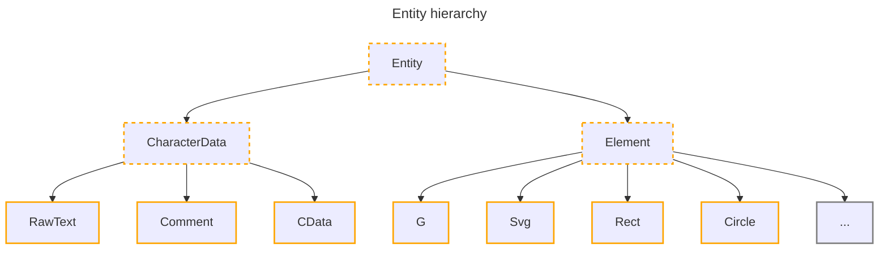

<div align="center">
  

  <h1 align="center">
    <picture>
      <source media="(prefers-color-scheme: dark)" srcset="https://raw.githubusercontent.com/reznakt/svglab/refs/heads/main/assets/wordmark-dark.svg" />
      
    </picture>
  </h1>

  <p align="center">
    <em>The Python library for parsing, manipulating, and optimizing SVG files</em>
  </p>

  <p align="center">
    <a href="https://pypi.org/project/svglab/"></a>
    <a href="https://pypi.org/project/svglab/"></a>
    <a href="https://pypi.org/project/svglab/"></a>
    <a href="https://codecov.io/github/reznakt/svglab"></a>
    <br />
    <a href="https://svglab.rocks/"></a>
    <a href="https://pepy.tech/project/svglab"></a>
    <a href="https://github.com/reznakt/svglab/blob/main/LICENSE"></a>
  </p>
</div>

<br />

## About the project

### Features

- Full SVG 1.1 coverage &mdash; all 80 elements and 295 attributes
- Typed, validated attributes via [Pydantic](https://pypi.org/project/pydantic/)
- 20+ configurable formatting and optimization options
- Raster rendering via [resvg](https://lib.rs/crates/resvg), through bindings that ship with the library
- Bounding box and mask computation
- Transform reification (baking transforms into geometry)

See the [Overview](https://reznakt.github.io/svglab/overview/) for a detailed description of each capability.



## Getting started

### Prerequisites

- [CPython](https://www.python.org/) 3.11+
- [Rust](https://rustup.rs/) 1.85+ and a C compiler for linking (source builds only; when `cargo` is missing, the build downloads Rust itself)
- `clippy` and `rustfmt` (development only; used by `just lint` and `just format`)
- [uv](https://docs.astral.sh/uv/) (development only)
- [just](https://just.systems/) (development only; optional)

### Installation

```sh
pip install svglab
```

For alternative package managers (Poetry, uv) and installing from source, see the [Installation guide](https://reznakt.github.io/svglab/getting-started/installation/).

## Usage

```python
from svglab import parse_svg, Rect, Circle, Length, Color

# Parse an SVG
svg = parse_svg('<svg width="200" height="200"><circle cx="50" cy="50" r="40"/></svg>')

# Find and modify elements
circle = svg.find(Circle)
circle.fill = Color("red")

# Add new elements
svg.add_child(Rect(x=Length(10), y=Length(10), width=Length(30), height=Length(30)))

# Serialize
svg.save("output.svg")
```

For a complete walkthrough, see the [Quickstart](https://reznakt.github.io/svglab/getting-started/quickstart/).

## Development

### Setup

```sh
# Install dependencies
uv sync

# Activate the virtual environment
source .venv/bin/activate

# Optional: Install the pre-commit hooks
prek install
```

### Common tasks

```sh
# Rebuild the Rust extension after changing the crate
just build

# Run tests
just test

# Run type checker
just typecheck

# Run linter
just lint

# Fix linting errors
just lint-fix

# Run formatter
just format

# Fix formatting errors
just format-fix
```

## License

This software is distributed under the MIT License. See [`LICENSE`](LICENSE) for more information.
